# CYSE 425 — Lab 7: Bluetooth & NFC

**Student:** Harshith Motipalli  
**Instructor:** Professor Gebril  
**Tools:** Wireshark, Bluetooth HCI, USB, NFC/CCID

## Overview

This lab examines Bluetooth pairing and connection traffic and NFC reader communication through captured Wireshark frames. The repository documents **six Bluetooth tasks and three NFC tasks** using the screenshots and findings from the 11-page lab report.

## At a Glance

| Analysis | Observation |
| --- | --- |
| Bluetooth device | Murata Manufacturing Co., Ltd. |
| Bluetooth MAC | 00:0E:6D:07:2E:FA |
| PIN code | 1234 (Frame 12) |
| Connection type | ACL, 0x01 (Frame 22) |
| L2CAP PSM | SDP, 0x0001 (Frame 64) |
| SDP service | Headset, UUID 0x1108 (Frame 77) |
| Remote device name | NEC 616 (Frame 79) |
| NFC reader | ACR122U, vendor ID 0x072F, product ID 0x2200 |
| Smart card | Present and active at Frame 170 |

## Bluetooth Analysis

### Task 1 — Identify the manufacturer

**Question:** What is the manufacturer of the Bluetooth device?

**Finding:** The device's manufacturer is **Murata Manufacturing Co., Ltd.** Its MAC address is **00:0E:6D:07:2E:FA**, and its OUI identifies Murata Manufacturing.

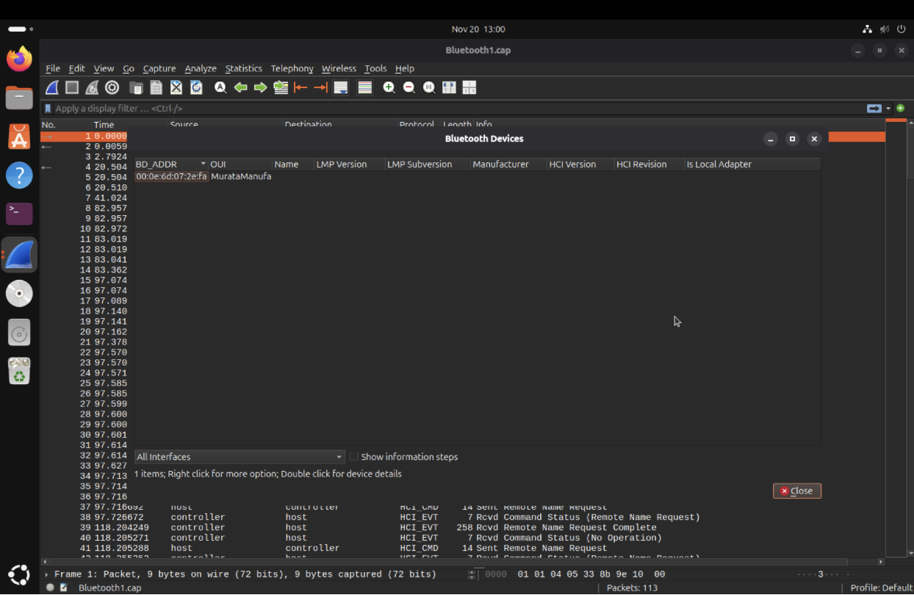

### Task 2 — Find the pairing PIN

**Question:** What was the PIN code?

**Finding:** The PIN was **1234**, shown in **Frame 12** under the Bluetooth HCI PIN Code Request Reply. Its length was four bytes.

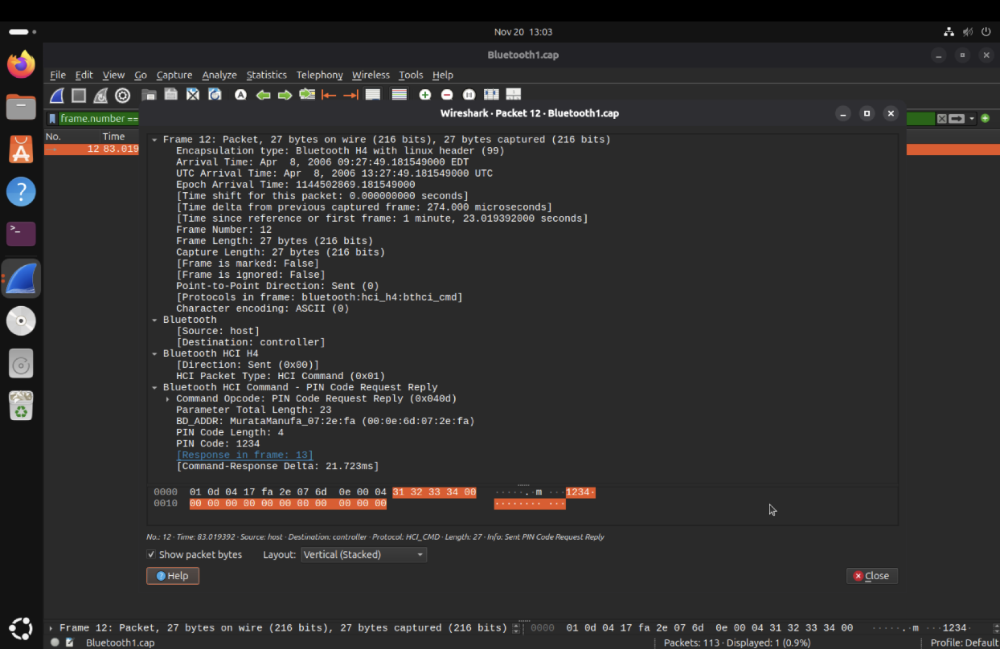

### Task 3 — Determine the link type

**Question:** What is the link connection type?

**Finding:** The connection is **ACL (Asynchronous Connection-Less)** with type **0x01**. Frame **22** shows the Connection Complete event with success status **0x00**.

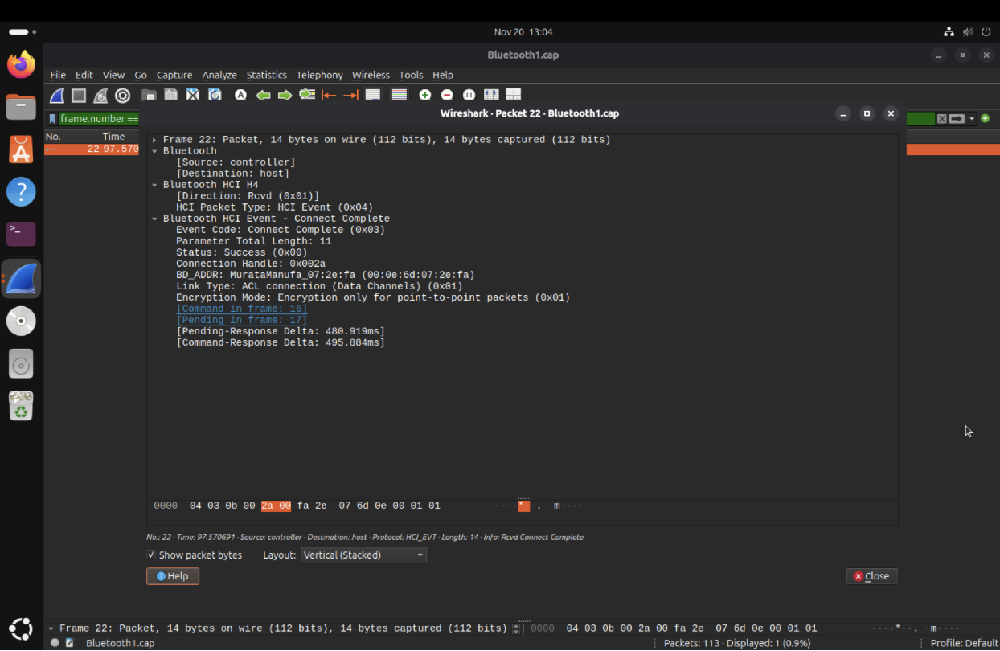

### Task 4 — Identify the PSM

**Question:** What is the Protocol Service Multiplexor type?

**Finding:** The PSM was **SDP (Service Discovery Protocol)**, value **0x0001**, in the Bluetooth L2CAP Connection Request in **Frame 64**.

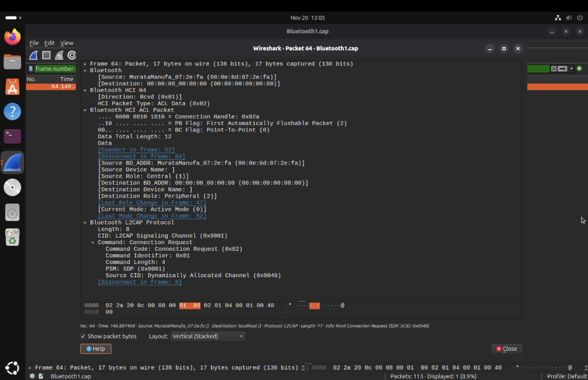

### Task 5 — Identify the service search pattern

**Question:** What was the service search pattern?

**Finding:** The service search pattern was **Headset (UUID 0x1108)**, found in **Frame 77** in the SDP Service Search Attribute Request.

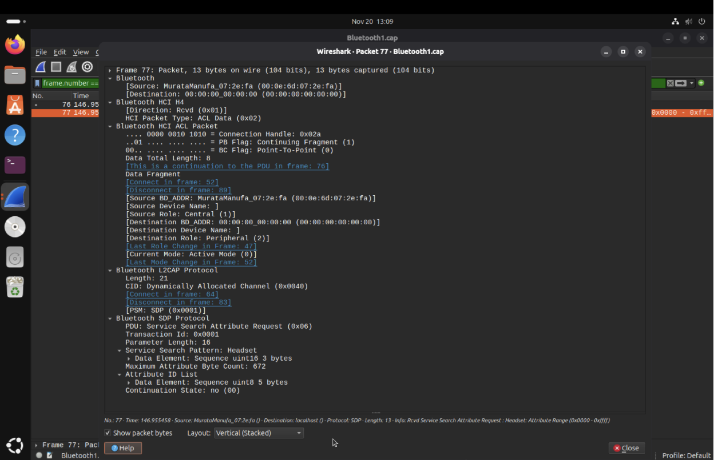

### Task 6 — Identify the remote name

**Question:** What was the remote name?

**Finding:** The remote name was **NEC 616**, identified in **Frame 79** under Remote Name Request Complete.

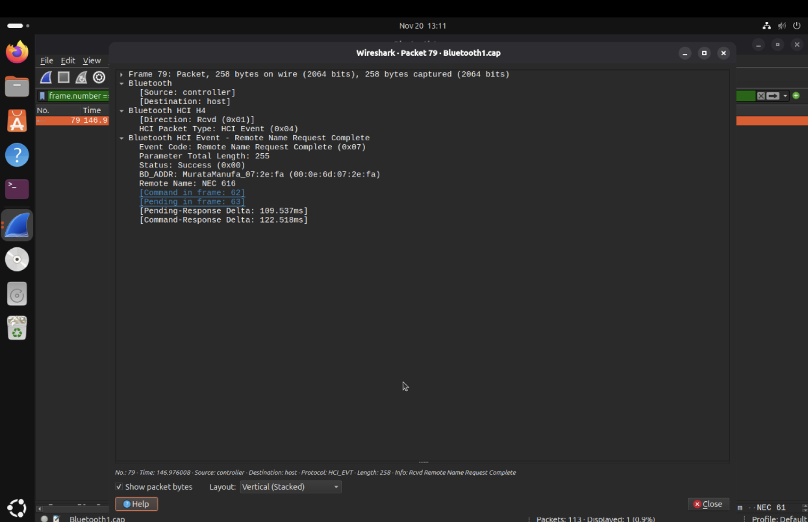

## NFC / USB Analysis

### Task 1 — Identify monitored devices

**Question:** Name some of the devices being monitored.

**Finding:** Wireshark USB device descriptors identify the **HP Webcam-101**, **Linux USB 2.0 Root Hub**, **Linux USB 1.1 Root Hub**, and **ACR122U NFC contactless card reader**. These appear in Frames **2, 4, 8, and 10**. The four screenshots below are all part of this one task.

**Frame 2 — HP Webcam-101**

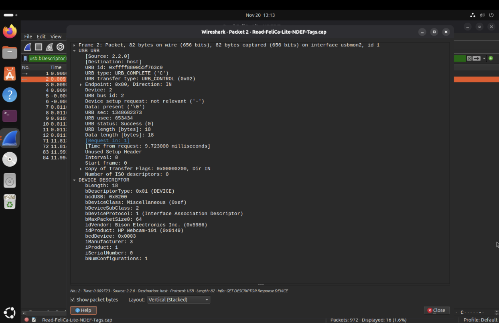

**Frame 4 — Linux USB 2.0 Root Hub**

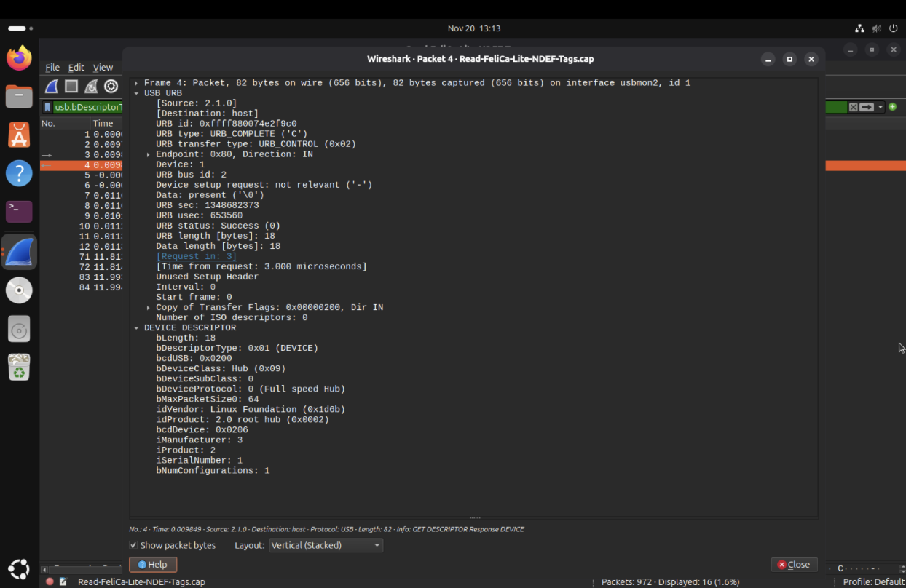

**Frame 8 — Linux USB 1.1 Root Hub**

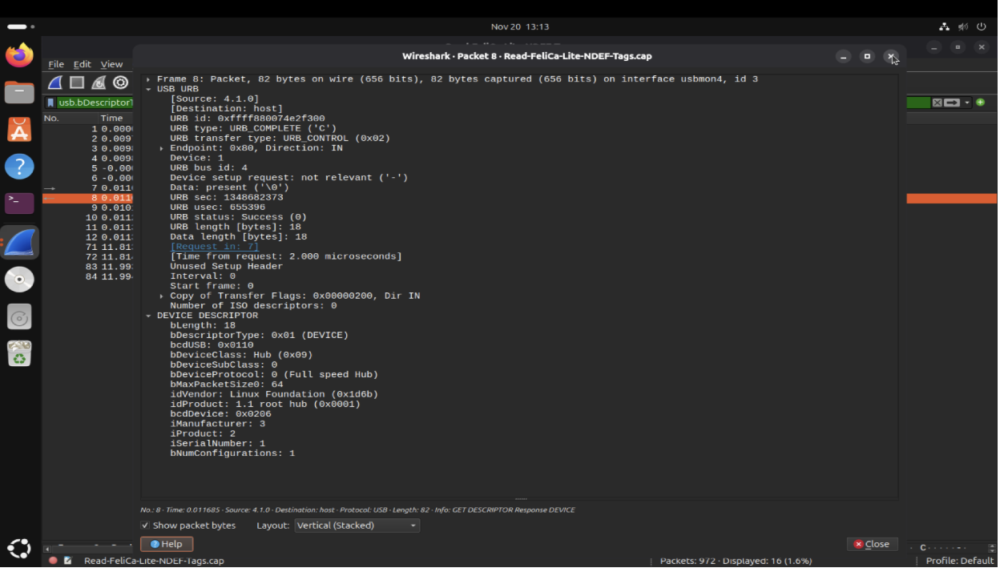

**Frame 10 — ACR122U NFC reader**

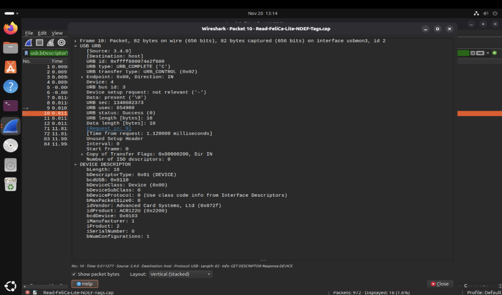

### Task 2 — Identify the NFC reader vendor

**Question:** Who is the vendor of the ACR122U NFC contactless card reader?

**Finding:** The vendor is **Advanced Card Systems, Ltd. (ACS)**. Frame **10** displays Vendor ID **0x072F** and Product ID **0x2200**.

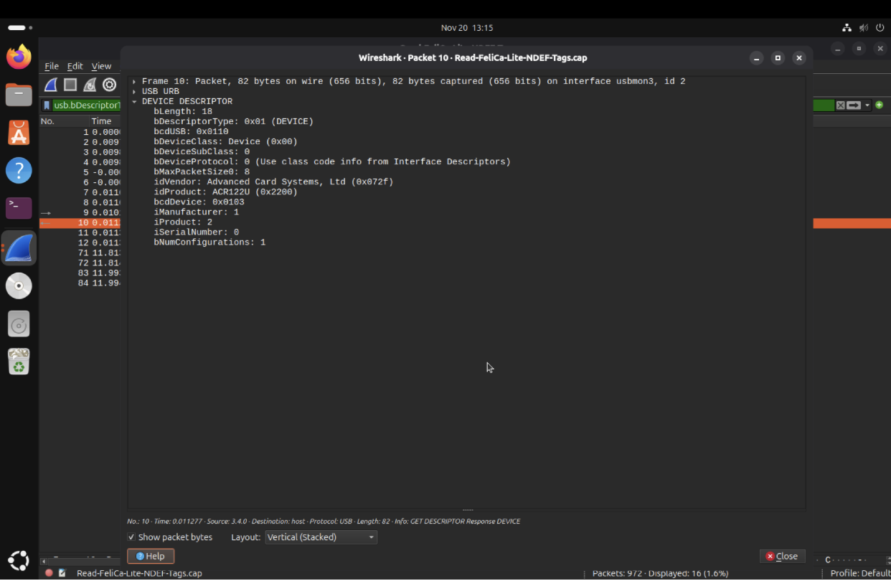

### Task 3 — Determine when the smart card became active

**Question:** Identify when at least one smart card became active.

**Finding:** A smart card was confirmed present and active in **Frame 170**, approximately **194.907503 seconds** into the capture. The USB CCID response indicates ICC status **0x00**, processed without error.

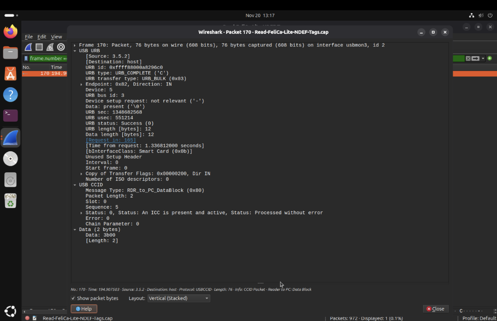

## Full Lab Report

[View the complete 11-page CYSE 425 Lab 7 report](docs/CYSE425-Lab7-Bluetooth-NFC-Report.pdf). The repository PDF is optimized for size, with all 11 pages and the original text preserved.

## Repository Structure

- **assets/bluetooth/** — Six Bluetooth task screenshots.
- **assets/nfc/** — Six NFC screenshots organized across three tasks.
- **docs/** — Full Bluetooth & NFC assignment report.
- **README.md** — Task-by-task findings and visible evidence.

**Note:** The screenshots reference Wireshark captures named Bluetooth1.cap and Read-FeliCa-Lite-NDEF-Tags.cap. These raw capture files were not part of the current repository upload.

## Skills Demonstrated

Wireshark packet inspection · Bluetooth device identification · Legacy PIN exchange · ACL connections · L2CAP/SDP · USB device descriptors · NFC reader identification · USB CCID smart-card analysis
